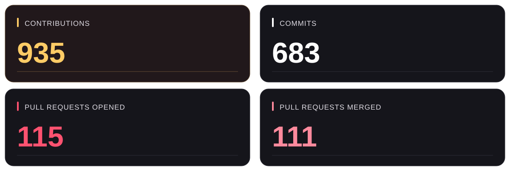
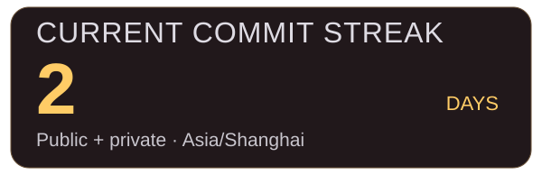

  

 

<h2 align="center">On the scoresheet</h2>

Every commit counts. Every merge moves things forward.

  <picture>
    <source media="(max-width: 600px)" srcset="assets/activity-mobile-94706bb70648.svg" />
    
  </picture>

<!-- ACTIVITY:START -->

Public + private &nbsp; · &nbsp; All time &nbsp; · &nbsp; Updated 2026-10-17 UTC

About these numbers

Contributions follow GitHub’s calendar rules, including eligible code reviews and private activity. Commit and PR counts use GitHub search; the cards are not additive.

Only aggregate counts visible to the authorized account are published.

The commit streak counts consecutive author-date days in Asia/Shanghai. If there is no commit today yet, a streak ending yesterday stays active. PRs and reviews do not extend it.

<!-- ACTIVITY:END -->

 

<h2 align="center">Keep the streak moving</h2>

  

  <picture>
    <source media="(prefers-color-scheme: dark)" srcset="https://raw.githubusercontent.com/ShayChen817/ShayChen817/output/github-contribution-grid-snake-dark.svg" />
    <source media="(prefers-color-scheme: light)" srcset="https://raw.githubusercontent.com/ShayChen817/ShayChen817/output/github-contribution-grid-snake.svg" />
    
  </picture>

 

  <h2>The celebration stays.</h2>
  
  
<strong>SIUUUUU!</strong> One more commit. One more goal.

    

