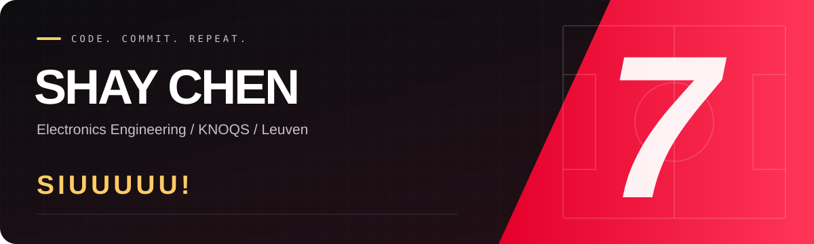
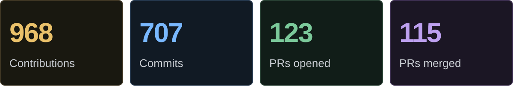

  

 

## On the scoresheet

Every commit counts. Every merge moves things forward.

  

<!-- ACTIVITY:START -->
Public + private · past 365 days · updated 2026-10-16 UTC · counts only.
 GitHub-indexed activity visible to the authorized account. Repository names and activity details are never published.
<!-- ACTIVITY:END -->

 

## Keep the streak moving

  <picture>
    <source media="(prefers-color-scheme: dark)" srcset="https://raw.githubusercontent.com/ShayChen817/ShayChen817/output/github-contribution-grid-snake-dark.svg" />
    <source media="(prefers-color-scheme: light)" srcset="https://raw.githubusercontent.com/ShayChen817/ShayChen817/output/github-contribution-grid-snake.svg" />
    
  </picture>

 

  <h2>The celebration stays.</h2>
  
  
<strong>SIUUUUU!</strong>

  One more commit. One more goal.
    

